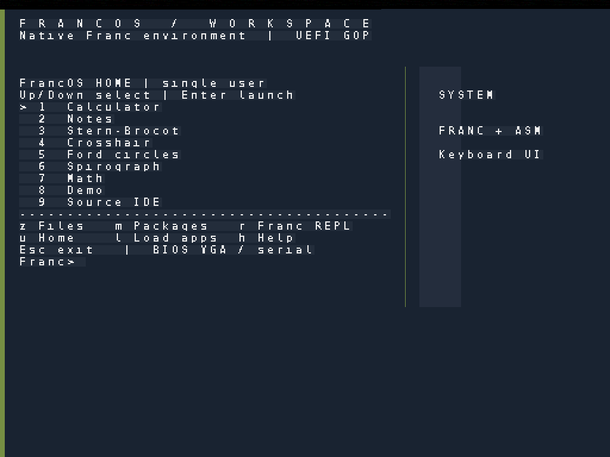
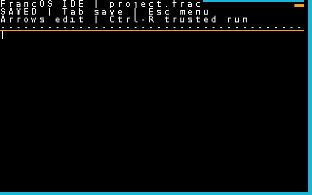
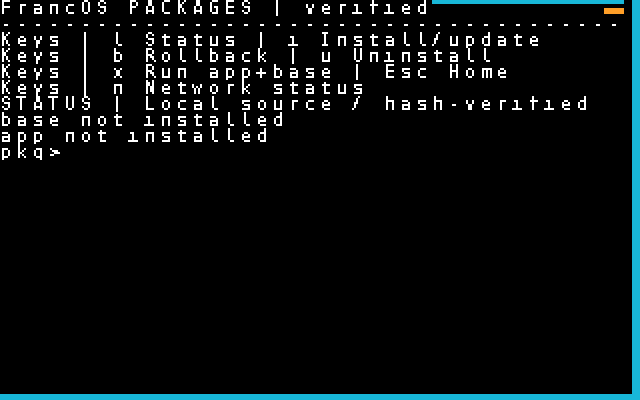

# Franc / FrancOS

A self-hosting x86-64 operating system and programming language built around
exact rational arithmetic.

**Built entirely by AI, with Rubén Sánchez providing design direction and taste oversight.**

[Documentation](docs/README.md) · [Build and run](docs/BUILD_AND_TEST.md) ·
[Contributing](CONTRIBUTING.md) · [Releases](https://github.com/Rsan0948/franc/releases)

## About

Franc brings a stack-based language, native compiler, and operating system
together in one project. Ratios are the language's core numeric type, and
the OS provides a keyboard-driven environment for programming, mathematical
exploration, and everyday tools.

The kernel and compiler use Franc and assembly. FrancOS can rebuild its
native kernel from source inside a running guest, producing byte-for-byte
reproducible generations. Development and testing take place in QEMU, with
BIOS and UEFI boot paths.

## Screenshots

[](docs/screenshots/home-uefi-1024x768.png)

| Source editor (BIOS) | Packages (BIOS) |
| --- | --- |
| [](docs/screenshots/ide-bios-640x400.png) | [](docs/screenshots/packages-bios-640x400.png) |

[Gallery and capture sources](docs/screenshots/README.md). These QEMU captures
record the UEFI workspace and BIOS app interfaces from the v1.1 development period.

## Features

- **Franc language:** rational arithmetic, word definitions, branching, loops,
  interactive execution, native JIT compilation, and kernel AOT compilation.
- **Applications:** calculator, notes, source editor, mathematical explorers,
  and graphics demos in a keyboard-driven workspace.
- **Persistent storage:** file management and offline packages with content
  verification, dependency checks, updates, rollback, and uninstall.
- **Kernel:** memory management, interrupts, scheduling, and protected Ring 3
  execution for the supported Franc user-program subset.
- **Drivers and networking:** VGA and UEFI GOP graphics, PS/2 input, ATA storage,
  e1000 Ethernet, IPv4, ICMP, UDP, and DNS.
- **Self-hosting:** native kernel rebuilds and portable Franctxt configuration
  with source and build identities.

## The language

Franc uses postfix notation and a stack:

```text
1/3 1/6 +      \ produces 1/2
def sq dup * ;
5 sq           \ produces 25
```

Core numbers are normalized pairs of signed 64-bit integers, giving exact
rational results within that range. Libraries cover continued fractions,
fixed-point approximation, intervals, big integers, and mathematical graphics.
The [mathematical foundation](docs/MATHEMATICAL_FOUNDATION.md) explains the
numeric model, exceptional values, and library algorithms.

## Build and run

On x86-64 Linux, the BIOS build uses GNU binutils, Make, sh/bash, awk, dd,
and QEMU. UEFI builds additionally use Clang, LLD, and mtools, with OVMF
firmware for the guest.

```sh
make os                    # Build the BIOS image
make os-uefi               # Build the UEFI adapter and EFI system partition
tools/run_francos.sh uefi  # Launch FrancOS
```

Use `tools/run_francos.sh bios` for the BIOS display. The launcher preserves
user files across launches. See the [build guide](docs/BUILD_AND_TEST.md) for
setup, firmware paths, and tests, or browse the
[release images](https://github.com/Rsan0948/franc/releases).

The hosted Franc interpreter can also be built and run with `make` and `./frac`.

## Documentation and development

The [documentation index](docs/README.md) covers using the apps, building the
system, the language, architecture, and development history.

Run `make os-proof` to rebuild and compare native kernel generations inside
QEMU. Guest acceptance tests exercise storage, apps, protected execution,
networking, and framebuffer output. The [contribution guide](CONTRIBUTING.md)
explains the source layout and validation workflow; the
[security policy](SECURITY.md) describes privilege and trust boundaries.

## License

Franc is distributed under the [MIT license](LICENSE). The bundled font's
upstream attribution and redistribution terms are in
[FONT-LICENSE.txt](FONT-LICENSE.txt).
