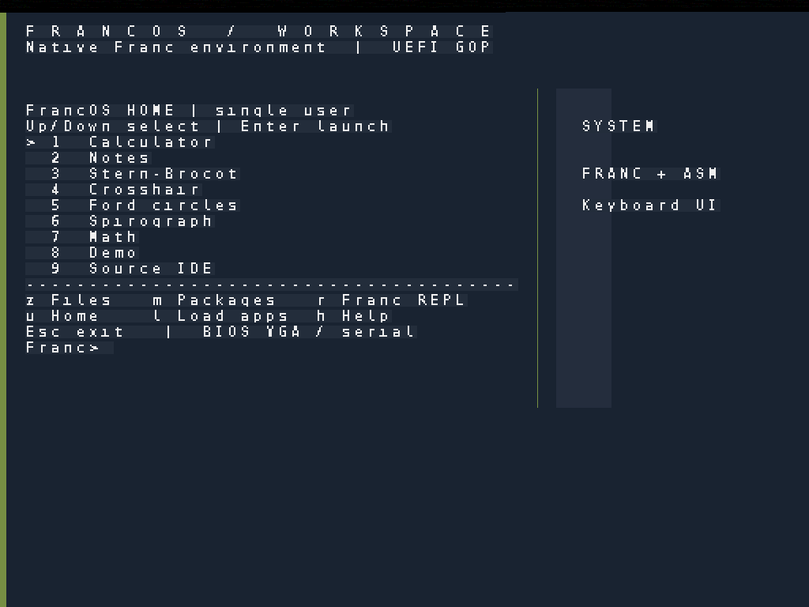
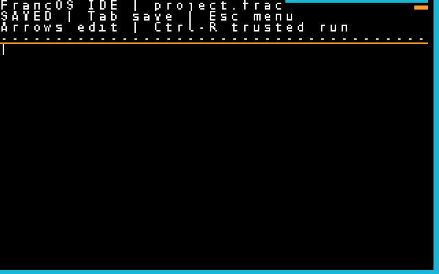
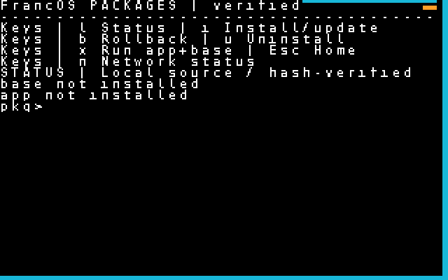

# FrancOS release-media gallery (draft for next approved release)

FrancOS is a self-hosting operating system built entirely by AI, with
Rubén Sánchez providing design direction and taste oversight. This draft
introduces its native UEFI workspace, apps, and mathematical tools. Pin
media links to the tested release tag when preparing the announcement.

## See FrancOS running

*FrancOS native 1024×768 UEFI Home. Captured from a real guest.*

| IDE | Package Manager |
| --- | --- |
|  |  |

## See the evolution

[Initial 1024×768 UEFI boot screen](https://github.com/Rsan0948/franc/blob/main/docs/screenshots/home-uefi-initial-1024x768.png) ·
[Updated UEFI Home](https://github.com/Rsan0948/franc/blob/main/docs/screenshots/home-uefi-1024x768.png) ·
[Complete screenshot gallery](https://github.com/Rsan0948/franc/tree/main/docs/screenshots)

These images are lossless PNG conversions of genuine QEMU/OVMF screenshots.
Their source workflows and SHA-256 digests are recorded in
[the screenshot provenance file](https://github.com/Rsan0948/franc/blob/main/docs/screenshots/SOURCES.md).

The gallery includes the 1024×768 UEFI workspace and the compact BIOS app
interfaces, with captions identifying each display.

Before release, replace references to `main` above with the exact tested
release tag, confirm the release actually includes the graphics branch, and
attach the six PNGs to the GitHub Release as downloadable image assets.
Publish only after the repository owner explicitly approves.
