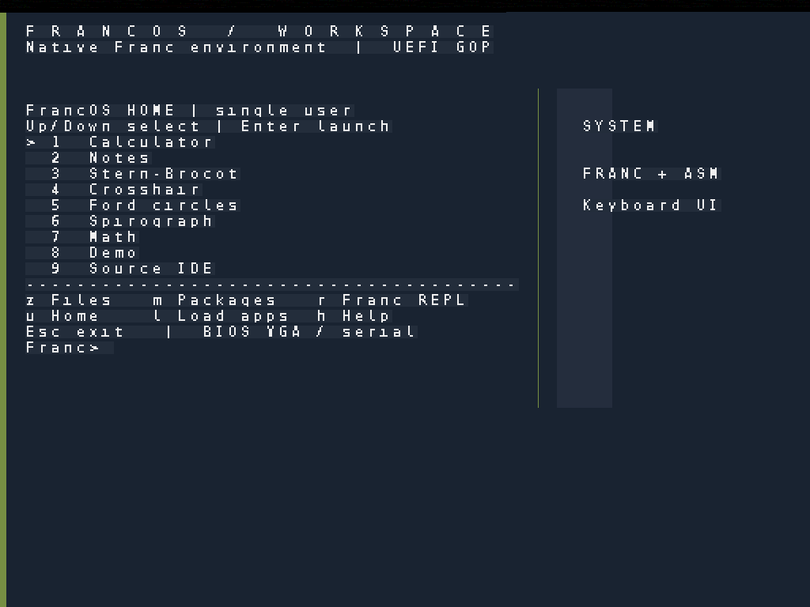
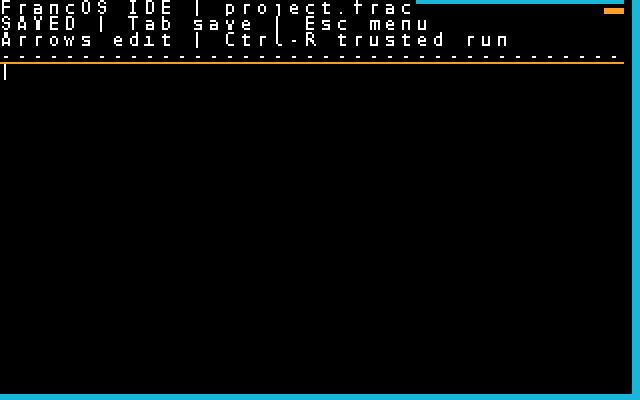
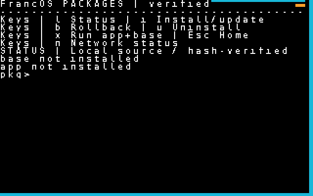

# FrancOS v1.1.0 Experimental — Native UEFI Graphics and Open-Source Preview

FrancOS is a self-hosting experimental x86-64 operating system and the
Franc programming language. This is a **pre-release**, not a hardened or
general-purpose desktop system.

## What's new since the frozen v1.0 experimental tag

- **1024×768 UEFI graphics** under QEMU/OVMF. The UEFI GOP adapter hands
  video mode information to the Franc/assembly runtime; fonts and Home
  visuals are drawn by FrancOS rather than a host-side overlay.
- Updated keyboard-driven Home visuals and improved BIOS IDE/Packages
  screen accents, with real QEMU screenshot regression checks.
- Documentation organized for new contributors, architecture/source
  ownership map, shared QEMU visual test helpers, and launch checklist.
- Six losslessly converted, SHA-256 verified **real QEMU screenshots**
  committed to the source tree.

## Actual running screenshots

[](https://github.com/Rsan0948/franc/blob/francos-v1.1.0-experimental/docs/screenshots/home-uefi-1024x768.png)

| IDE — tested BIOS viewport | Packages — tested BIOS viewport |
| --- | --- |
| [](https://github.com/Rsan0948/franc/blob/francos-v1.1.0-experimental/docs/screenshots/ide-bios-640x400.png) | [](https://github.com/Rsan0948/franc/blob/francos-v1.1.0-experimental/docs/screenshots/packages-bios-640x400.png) |

[Full screenshot gallery](https://github.com/Rsan0948/franc/tree/francos-v1.1.0-experimental/docs/screenshots) — includes both before and after UEFI Home views.

## Download and boot

Release assets include:
- `francos-v1.1.0-experimental-bios.img`: bootable BIOS/IDE disk with
  native FrancOS kernel and bundled applications
- `francos-v1.1.0-experimental-uefi-esp.img.gz`: compressed FAT EFI system
  partition; decompress before use, keeping the BIOS/ATA image attached too
- `francos-v1.1.0-experimental-BOOTX64.EFI`: the standalone x64 UEFI adapter
- `francos-v1.1.0-experimental-screenshots.zip`: six real screenshot PNGs
- `francos-v1.1.0-experimental-SHA256SUMS`: integrity hashes for assets

For a BIOS guest (after downloading the disk image):

```sh
qemu-system-x86_64 -m 128M -accel tcg -vga std \
  -drive file=francos-v1.1.0-experimental-bios.img,format=raw,if=ide
```

For UEFI, install QEMU/OVMF, decompress the EFI ESP image, and attach both
the BIOS/ATA disk and the EFI ESP, with OVMF firmware as demonstrated in
[`stage4/uefi/test_boot.py`](https://github.com/Rsan0948/franc/blob/francos-v1.1.0-experimental/stage4/uefi/test_boot.py).

## Verified scope and limitations

The release workflow requires an exact-commit Franc-native self-hosting
proof, QEMU boot and UI journeys, protected-user-program regressions,
offline package lifecycle, real UDP/DNS network traffic, and OVMF GOP
capture, plus current-tree and basic Git-history credential scans.

The BIOS path remains the established 320×200 guest VGA mode (QEMU may
capture it at 640×400). **The UEFI graphics interface is not yet a full
windowed desktop**; the IDE and package manager do not yet have entirely
reworked 1024×768 graphical layouts. The trusted REPL executes at kernel
privilege; only a restricted Franc subset runs in Ring 3. Limited storage,
no HTTPS/TLS, and no production security guarantees.

This new release does not change or retag
[`francos-v1.0-experimental`](https://github.com/Rsan0948/franc/tree/francos-v1.0-experimental).
