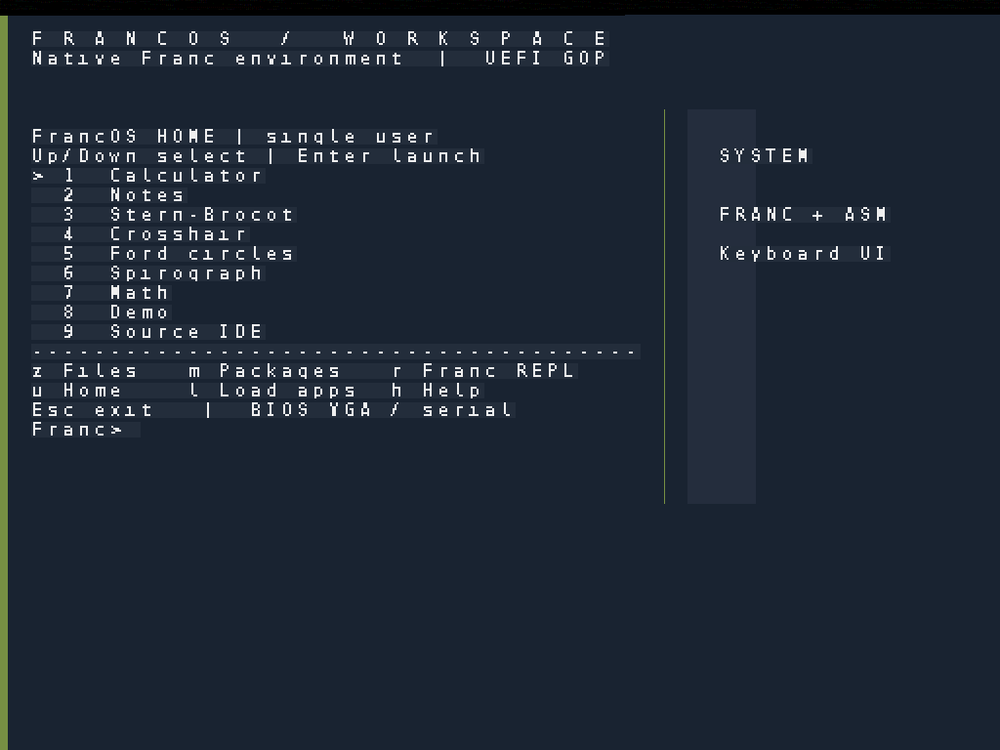
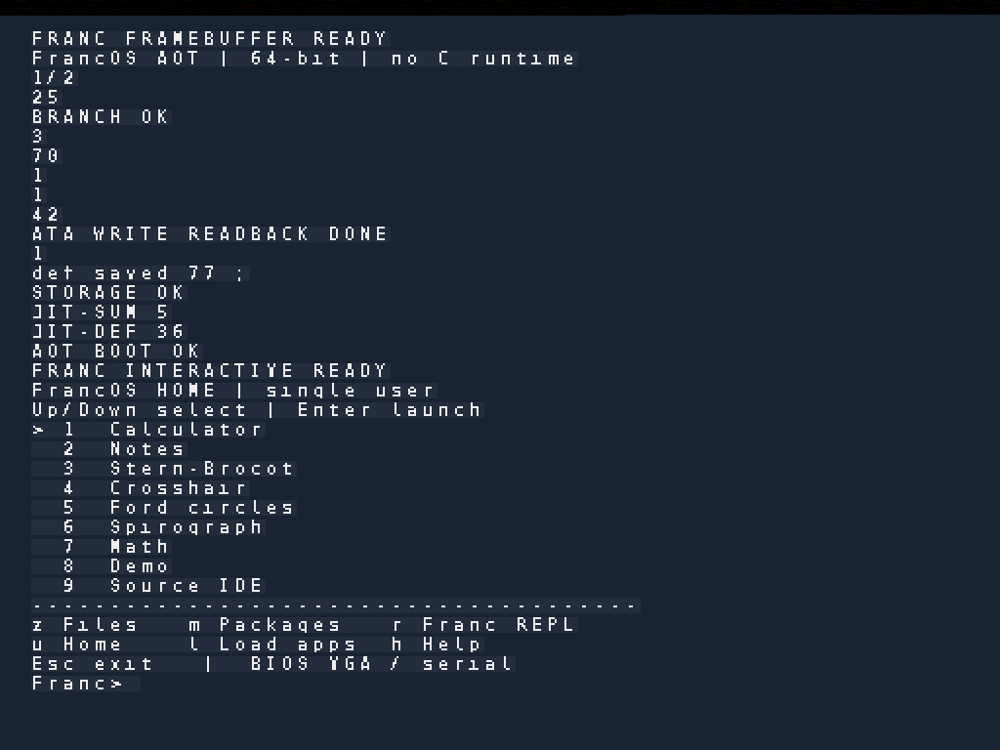
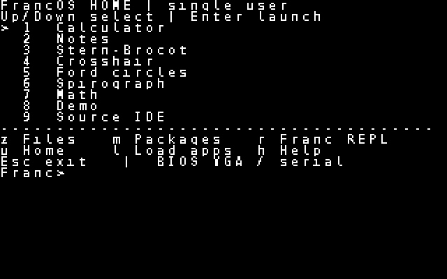
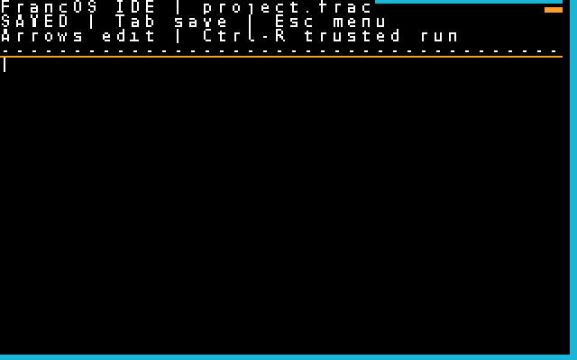
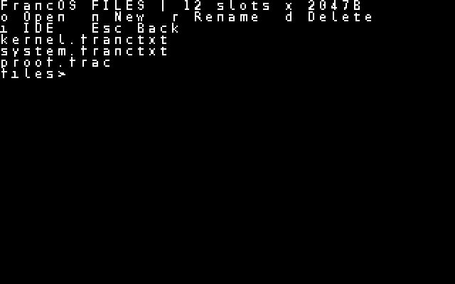
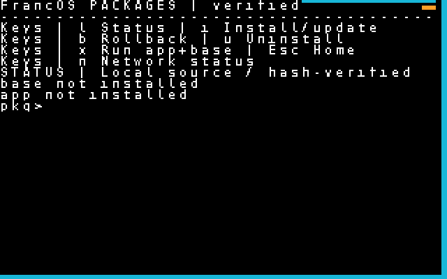

# FrancOS screenshots

These are **real screenshots captured from booted QEMU guests**. None were
generated by image models, composited as fictional user interfaces, or
retouched to depict unimplemented capabilities.

Select a picture to open its full-resolution PNG:

## High-resolution UEFI display — post-v1 development

*Updated Home screen, 1024×768, native FrancOS font rendering and workspace.*

*Original 1024×768 UEFI display showing the initial startup text. Included
as a before/after development reference.*

## BIOS graphics — 320x200 guest framebuffer (captured as 640x400 by QEMU)

| Home | IDE |
| --- | --- |
|  |  |

| Files | Packages |
| --- | --- |
|  |  |

**What these show:** the UEFI screenshots show the newer high-resolution
framebuffer work; the BIOS screenshots show the smaller keyboard-driven
application interfaces. They do not imply that every BIOS app already has
a native 1024×768 graphical layout.

See [sources and verification](SOURCES.md), and the [FrancUI roadmap](../FRANCUI_DESIGN.md).

The existing `francos-v1.0-experimental` tag predates the UEFI display
modernization. These launch images should accompany a **new, separately
verified release**, not be represented as screenshots bundled with the
original immutable tag.
